<div align="center">

<!-- ================= CYBER HACKER ANIMATED RED HEADER ================= -->


<a href="https://github.com/Lilnyx-exe">
  
</a>

<br/>

[](https://github.com/Lilnyx-exe)
[](https://github.com/Lilnyx-exe)
[](https://www.python.org/)
[](https://github.com/Lilnyx-exe)
[](https://tryhackme.com/)

</div>

---

## 💀 `whoami`

```python
class Lilnyx:
    def __init__(self):
        self.alias = "Lilnyx"
        self.role = "Full-Stack Developer & Cybersecurity Enthusiast"
        self.team = "Thinking Team"
        self.location = "Sri Lanka"

        self.stack = {
            "frontend": ["HTML5", "CSS3", "JavaScript", "React.js"],
            "backend": ["Python", "Node.js", "REST APIs", "Flask/FastAPI"],
            "security": ["Penetration Testing", "Web App Security", "DDoS Mitigation"]
        }

        self.interests = [
            "Full-Stack Web Architecture",
            "Ethical Hacking & Red Teaming",
            "Web Application Security & OWASP Top 10",
            "Python Automation & Exploit Development",
            "Botnet Defense & Network Forensics",
            "CTF Challenges & Security Research"
        ]

        self.mindset = "Learn. Build. Break. Secure."

    def current_mission(self):
        return "Engineering bulletproof full-stack apps & smarter security tools."

me = Lilnyx()
print(me.current_mission())
```

> 🩸 **Full-Stack Developer** by creation, **Cybersecurity Enthusiast** by passion. Bridging modern, high-performance web development with defensive and offensive security research to engineer bulletproof digital architectures.

---

## `current-missions`

-  Build scalable, responsive Full-Stack applications with clean code architecture.
-  Learn ethical hacking, red teaming, and hands-on penetration testing.
-  Master web vulnerabilities, API security, and secure coding standards.
-  Develop custom Python tools for security automation, scanning, and intelligence.
-  Practice hands-on labs and CTF challenges on TryHackMe.
-  Improve full-stack software engineering and problem-solving skills every single day.

---

## `tryhackme`

<div align="center">

<a href="https://tryhackme.com/">
  
</a>

<br/><br/>


**Learn by doing. Hack ethically. Level up continuously.**

[⚔️ Open TryHackMe](https://tryhackme.com/)

</div>

<sub>TryHackMe figures above reflect the profile screenshot and may change. The badges are visual labels, not a live stats feed.</sub>

---

## `arsenal`

<div align="center">

### Full-Stack & Core Languages


### DevOps, Security & Operating Systems


</div>

---

## `TELEMETRY_STATS.exe`

<div align="center">


<br/><br/>

<table align="center" border="0" cellpadding="0" cellspacing="0">
  <tr>
    <td align="center" valign="middle" style="padding: 4px;">
      
    </td>
    <td align="center" valign="middle" style="padding: 4px;">
      
    </td>
  </tr>
</table>

<br/>


</div>

---

<div align="center">


<p align="center">
  
  
  
</p>

<!-- Pac-Man Devouring Contributions -->
<picture>
  <source media="(prefers-color-scheme: dark)" srcset="https://raw.githubusercontent.com/Lilnyx-exe/Lilnyx-exe/output/pacman-contribution-graph-dark.svg">
  <source media="(prefers-color-scheme: light)" srcset="https://raw.githubusercontent.com/Lilnyx-exe/Lilnyx-exe/output/pacman-contribution-graph.svg">
  
</picture>

<br/><br/>


</div>

---

## `mindset`

```text
[+] Think independently
[+] Architect cleanly (Full-Stack Engineering)
[+] Learn continuously
[+] Build with purpose
[+] Test in authorized environments
[+] Protect what matters

STATUS: ALWAYS LEARNING_
```

---

## `connect`

<div align="center">

<a href="https://github.com/Lilnyx-exe">
  
</a>

<a href="https://tryhackme.com/">
  
</a>

<br/><br/>

**“The goal isn't to look dangerous. The goal is to build powerful systems and understand security.”**


</div>
